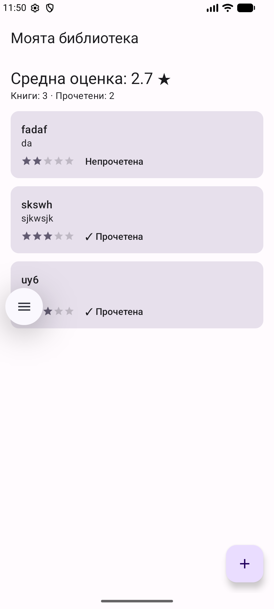
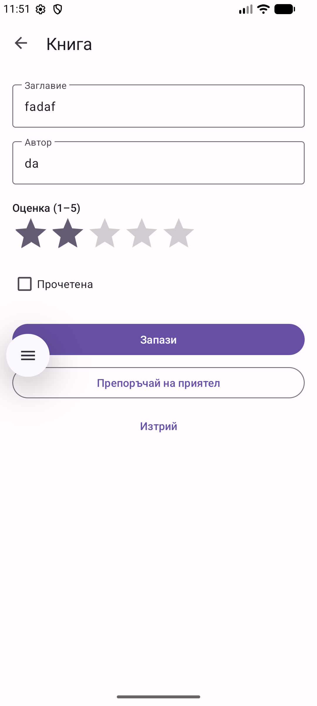

# BookShelf — Колекция от книги

Личен каталог на книги за Android. Дисциплина: „Мобилни приложения“.

**Автор:** Емине Мехмедова, ФН: 2401321019

## Идея

Приложението е личен каталог на книги. За всяка книга се пазят заглавие, автор, оценка от 1 до 5 и отметка дали е прочетена. Приложението показва средната оценка на всички книги и позволява да препоръчаш книга на приятел чрез Share Intent.

## Как работи

1. **Списък с книги.** Началният екран показва всички книги, подредени по заглавие. Най-горе се виждат средната оценка и броячите «Книги» и «Прочетени». Всяка книга е карта със заглавие, автор, звезди и статус.
2. **Добавяне.** Бутонът «+» отваря екран с полета за заглавие и автор, звезди за оценка (1–5) и отметка «Прочетена». Полетата за заглавие и автор са задължителни.
3. **Редакция.** Натискане върху книга от списъка отваря същия екран с попълнени данни. Промените се записват с бутона «Запази».
4. **Изтриване.** Има два начина: бутонът «Изтрий» в екрана за редакция (с потвърждение) и плъзгане на картата встрани в списъка. След плъзгане се показва съобщение с бутон «Отмяна», който връща книгата.
5. **Средна оценка.** Изчислява се автоматично от оценките на всички книги и се обновява веднага след всяка промяна.
6. **Препоръка на приятел.** Бутонът «Препоръчай на приятел» отваря системния прозорец за споделяне (Share Intent) с текст от вида: «Препоръчвам ти „Под игото“ от Иван Вазов ★★★★☆».
7. **Запазване на данните.** Книгите се пазят в локална база данни (Room/SQLite) и остават след рестарт на приложението.
8. **Тема.** Приложението използва Material 3 и следва светлия или тъмния режим на телефона.

## Архитектура

Приложението е изградено по MVVM с Repository слой и ръчно инжектиране на зависимости.

| Слой | Класове | Отговорност |
|---|---|---|
| UI | `MainActivity`, `BookListFragment`, `BookEditFragment`, `BookAdapter` | Показване на данните и обработка на действията на потребителя |
| ViewModel | `BookListViewModel`, `BookEditViewModel`, `ViewModelFactory` | Състояние на екраните и връзка с Repository |
| Repository | `BookRepository` | Единствена точка за достъп до данните |
| Данни | `Book`, `BookDao`, `AppDatabase` (Room) | Локална база данни |
| Domain | `Stats.kt` | Средна оценка, статистика и текст за споделяне |
| DI | `BookShelfApp` | Ръчен контейнер, който създава базата и Repository |

- **Навигация:** Navigation Component с два екрана (списък и редакция).
- **Технологии:** Kotlin, Room, LiveData, Coroutines/Flow, ViewBinding, Material 3.
- **Минимална версия:** Android 7.0 (API 24).

## Потребителски поток

```
Списък с книги ──(+)────────────► Добавяне ──(Запази)──► Списък
       │
       ├──(натискане върху книга)► Редакция ──(Запази)──► Списък
       │                               ├──(Препоръчай на приятел)──► Системен прозорец за споделяне
       │                               └──(Изтрий + потвърждение)──► Списък
       │
       └──(плъзгане встрани)─────► Изтриване + «Отмяна»
```

## Стъпки за стартиране

1. Клонирай репото:
   ```
   git clone https://github.com/EmiMehmedova/MobileApps2026--2401321019-.git
   ```
2. Отвори проекта в Android Studio.
3. Изчакай Gradle Sync да приключи.
4. Избери емулатор или свързано устройство и натисни **Run ▶**.

Тестове:
- Unit тестове: `./gradlew testDebugUnitTest`
- UI тест (Espresso, нужен е стартиран емулатор): `./gradlew connectedDebugAndroidTest`

## Тестови акаунти

Не се изисква вход. Приложението работи локално, без акаунти и без интернет.

## Скрийншотове

| Списък | Добавяне / редакция | Споделяне |
|---|---|---|
|  |  |  |

## APK

Готов за инсталиране файл: [`apk/app-release.apk`](apk/app-release.apk) (около 5.4 MB).

Инсталиране на емулатор или устройство:
```
adb install -r apk/app-release.apk
```